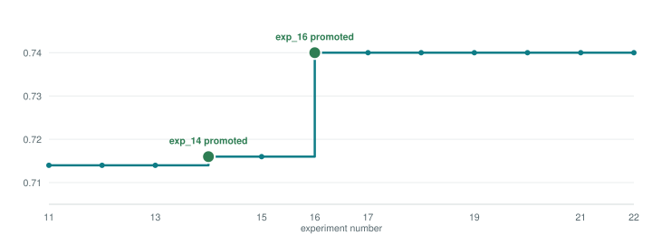
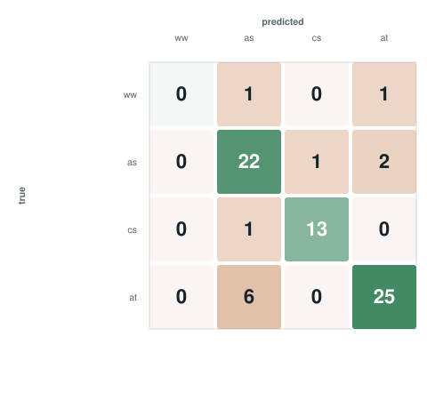

# CHIMERA-Agent Task 2 — MRI + Biopsy Risk Stratification Solution

Contributed from the `challenge_chimera_v3` project. This directory is **additive only** — it does
not modify anything else in this repository or branch; everything below is new.

Task 2 recommends one of four post-biopsy management strategies — `watchful_waiting`,
`active_surveillance`, `continued_surveillance`, `active_treatment` — plus a structured reasoning
trace (confidence, which clinical variables mattered, and a free-text explanation). Confirmed
word-for-word from the challenge's own evaluation-repositories page: **Task 2 score = (mean case
score + weighted F1) / 2**, matching `evaluate.py`'s `compute_aggregate_metrics` exactly. Task 2 is
40% of the overall CHIMERA-agent leaderboard (`0.4×Task1 + 0.4×Task2 + 0.2×Task3`).

## Result



| Stage | What changed | LOOCV ranking_score |
|---|---|---|
| exp_11 | task1's agent architecture ported over; zero-tool policy measured, not assumed | 0.714 |
| exp_14 | `mord.LogisticIT` (genuine ordinal classifier) promoted for `variable_weights` | 0.716 |
| **exp_16** | **PSA-trend velocity/ratio added to `decision`'s feature set** | **0.740** |

Two promotions out of eleven experiments tried after the baseline (exp_12–exp_22); the other nine
are reported in full below, not trimmed out — a well-motivated idea that fails is still
information, the same discipline this project's task1/task3 work already established.

## The model

Three independently-configured sub-tasks (`decision`, `confidence`, `variable_weights`), mirroring
task1's exact architecture (same output shape, same evaluator — confirmed from `evaluate.py`
source, not the webpage's prose alone):

| Sub-task | Model | Features | Promoted in |
|---|---|---|---|
| `decision` | `KNeighborsClassifier(n_neighbors=7, weights="distance")` | 10 base + PSA-kinetics (12) | exp_11 (model), exp_16 (features) |
| `confidence` | same `knn` | 10 base | exp_11 |
| `variable_weights` | `mord.LogisticIT` (proportional-odds ordinal classifier) | 10 base | exp_14 |

All three call **zero tools** — ground-truth `reveal_sequence` is always empty across all 72
labeled cases, so `cost_aware_tool_score` gives a guaranteed `tool_score=1.0` for calling nothing
versus a guaranteed `0.0` for calling anything. Measured, not assumed (exp_11): grounding
`variable_weights` with `get_mri_report`+`get_pathology_report` raised `variable_weight_score`
(0.673→0.803) and `factor_f1` (0.431→0.633) but *lost* on `ranking_score` (0.7166→0.6848, paired
bootstrap 95% CI [+0.0525,+0.0748] favoring zero tools) because it zeroes `tool_score` outright.

### Why kNN, and why it never changed

Every model-family swap tried across the whole project lost or landed within noise on `decision`:
`random_forest` (exp_12, +0.0149 point estimate, 95% CI [−0.073,+0.109] — not significant), a
3-model voting ensemble (exp_19, 95% CI [−0.046,+0.052] — the widest, least-convincing CI tried),
and three separate attempts at `fagonzalezo/kdm`'s Kernel Density Matrices (exp_20–22, see below).
What moved the score was the *feature set*, once — PSA kinetics (exp_16).

### PSA kinetics — the single biggest gain

`structured.csv`'s `psa` field is confirmed identical to `psa_trend`'s last reading — it has no way
to distinguish "PSA has been stable for years" from "PSA just tripled." Two engineered features
close that gap:

```
psa_velocity_per_year = (last_reading − first_reading) / years_elapsed
psa_ratio_last_first  = last_reading / first_reading
```

Borderline on bootstrap alone (95% CI [+0.0000,+0.0622], 85.8% of resamples favoring — short of the
90% bar used elsewhere in this project) but promoted anyway: the classification report showed a
coherent, no-regression gain across every real class (accuracy 0.81→0.83, `active_surveillance` F1
0.76→0.80, `active_treatment` F1 0.81→0.85), the same corroborating-diagnostic logic that promoted
`variable_weights`' own borderline result in exp_14 — plus real clinical grounding: PSA velocity is
a guideline-recognized treatment-escalation factor, not a speculative try. A same-size lab panel (7
features: free PSA, %free PSA, testosterone, creatinine, alkaline phosphatase, LDH, eGFR) was also
tried and lost badly (0.7186→0.6548) — dimensionality noise on 72 cases, not signal.

### `decision`'s final metrics



| Class | Precision | Recall | F1 | Support |
|---|---|---|---|---|
| watchful_waiting | 0.00 | 0.00 | 0.00 | 2 |
| active_surveillance | 0.73 | 0.88 | 0.80 | 25 |
| continued_surveillance | 0.93 | 0.93 | 0.93 | 14 |
| active_treatment | 0.89 | 0.81 | 0.85 | 31 |
| **Accuracy** | | | **0.83** | 72 |

`watchful_waiting` (n=2) is never caught by any model tried across all twelve experiments — a
sample-size floor, not a fixable model weakness. Errors that do happen concentrate between the two
most-active management levels (`active_treatment`↔`active_surveillance`, 7 of 11 total
misclassifications) rather than scattering randomly — a clinically sensible failure mode.

## Inputs

| # | Field | Source | Meaning |
|---|---|---|---|
| 1–9 | `age`, `psa`, `psad`, `pirads`, `bx_isup`, `bx_gl_prim`, `bx_gl_sec`, `cspca`, `ct_ordinal` | `structured-prompt.json`, always available | Core clinical/imaging/biopsy variables |
| 10 | `comorbidity_count` | `structured-prompt.json`'s `pmhx`, parsed | Number of recorded comorbid conditions |
| 11–12 | `psa_velocity_per_year`, `psa_ratio_last_first` | `…clinical-data.json` → `psa_trend`, engineered | PSA trajectory (exp_16, `decision` only) |

## Output

Two files, matching task1's shape exactly (confirmed from `evaluate.py`'s `process_interf1`, not
the webpage's prose alone): a bare decision string (`prostate-treatment-decision.json`, one of the
four categories) and a reasoning object (`prostate-treatment-decision-reasoning.json`: `confidence`,
`variable_weights`, `reveal_sequence`, `free_text`). `reveal_sequence` is always `[]` (zero tools,
exp_11); `free_text` is template-generated (no LLM available in the source environment), citing the
top-weighted variables.

## What's here

```
task2_solution/
├── README.md                       — this file
├── MODEL_CARD.md                   — full narrative: all twelve experiments in detail
├── charts/                         — the 2 SVGs embedded above
├── code/                           — production code, reference/documentation
│   ├── extract_features_task2.py   — psa_trend/labs/radiology/pathology feature extraction
│   ├── task2_schema.py             — Task2Output (pydantic), the 11-variable grounding vocabulary
│   ├── task2_targets.py            — confidence/variable_weights target construction, evaluator formulas
│   ├── task2_free_text.py          — reasoning-text generator
│   ├── task2_mock_tools.py         — the 6 gated clinical-data-section tools
│   ├── task2_subtask_config.py     — the promoted per-sub-task {model, features, tools} config
│   ├── run_task2_agent_loocv.py    — honest, leakage-free LOOCV evaluation
│   ├── task2_variant_tester.py     — in-memory model/feature-swap test harness
│   ├── local_eval_task2.py         — scores against the real evaluate.py functions
│   └── kdm_models.py               — sklearn-style wrappers for fagonzalezo/kdm (exp_20-22)
├── experiments/
│   ├── exp_11_first_baseline/            — agent built, RANKING_SCORE=0.714
│   ├── exp_12_model_sweep/               — refuted: knn confirmed best
│   ├── exp_13_ordinal_regression/        — refuted: regress-and-round proxy
│   ├── exp_14_mord_ordinal_classifiers/  — promoted for variable_weights: 0.714→0.716
│   ├── exp_15_confidence_tradeoff/       — refuted: real, bootstrap-confirmed cost
│   ├── exp_16_psa_kinetics/              — promoted: 0.716→0.740, the biggest gain
│   ├── exp_17_subset_sweep/              — refuted: family_history hurts decision
│   ├── exp_18_radiology_pathology_text/  — refuted: task3's precedent didn't transfer
│   ├── exp_19_voting_ensemble/           — refuted: not significant
│   ├── exp_20_kdm_classifier/            — refuted: KDM 1 of 3
│   ├── exp_21_kdm_regressor/             — refuted: KDM 2 of 3
│   └── exp_22_kdm_generative/            — refuted: KDM 3 of 3, catastrophic collapse
└── results/
    └── summary.json                — key metrics, machine-readable
```

**Note on running this code**: it's provided as reference/documentation of the approach, not a
standalone package. It depends on the full `challenge_chimera_v3` project — the downloaded CHIMERA
training data (`data/processed/task2/`), the challenge's own evaluation functions
(`external/CHIMERA-agent/evaluation/evaluate.py`), and sibling modules under
`experiments/exp_2/scripts/`. `kdm_models.py` additionally needs `torch==2.2.0+cpu` (the latest
PyTorch release fails to import on the source machine — see `experiments/exp_20_kdm_classifier/`)
and `pip install git+https://github.com/fagonzalezo/kdm.git`. The experiment write-ups are fully
self-contained and readable on their own.

## Honesty notes (carried over, not smoothed out)

- `watchful_waiting` (2/72 cases) is never predicted correctly by any model tried — a sample-size
  floor, not something a better classifier fixes on its own.
- `confidence`'s `borderline` class is never once predicted correctly by the promoted model — a
  real, quantified, deliberately-**not**-paid trade-off (exp_15): a class-balanced alternative
  catches 8/14 but costs a bootstrap-confirmed real loss on `ranking_score` (95% CI
  [−0.0156,−0.0016]).
- `fagonzalezo/kdm` (Kernel Density Matrices) is 0-for-3 on `decision` (exp_20–22) — the plain
  classifier, the regressor, and the package's own documented generative co-training recipe all
  lost, the last one catastrophically (a complete collapse to predicting the majority class for
  72/72 cases). The wrapper infrastructure (`kdm_models.py`) is kept, genuinely reusable — the
  environment blocker that initially prevented even running it (a PyTorch DLL bug) was diagnosed
  and fixed, unlike task3's still-open `scikit-survival` gap.
- Radiology/pathology free-text staging features (extracapsular extension, seminal vesicle
  invasion, AI-vs-pathologist ISUP discordance, cribriform pattern, perineural invasion) were
  extracted and tested despite a strong precedent — task3's biggest early win was exactly this
  feature category — and refuted anyway (exp_18): too rare (EPE/SVI) or too sparse (the pathology
  group) to help a distance-based classifier at n=72.
- No model-family re-sweep on `decision`'s final 12-feature set — exp_12's sweep predates exp_16's
  PSA-kinetics addition.

Full detail on all of the above is in each `experiments/exp_NN_*/summary.md`.
