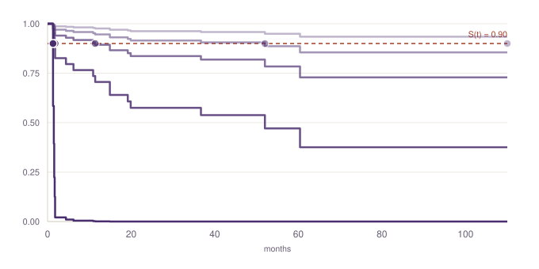

# Model card — Task 3 biochemical-recurrence predictor

This document describes the implemented model end to end: what it receives, how the raw data is
turned into model-ready numbers, which models were actually tried, and what it returns. It
complements (doesn't repeat) `equations.md` — the math derivation lives there; this document is the
data and modeling narrative.

---

## 1. Task

Predict `months_to_recurrence`: time to biochemical recurrence (BCR) after radical prostatectomy,
or time to last follow-up if no recurrence is observed. Scored by Harrell's concordance index
(C-index) against the true `(time, event)` pair — a ranking metric, not a calibration metric: only
the relative order of predictions across cases matters for the score.

- **Cohort**: 75 cases, all labeled. 19 observed recurrences (event=1), 56 censored (event=0).
  Follow-up ranges 1.3–110 months.
- **Evaluation protocol**: leave-one-out cross-validation (LOOCV) throughout — chosen over k-fold
  because an earlier experiment on this same project's task-1 work showed 5-fold CV can produce a
  leakage-driven false win at this sample size (a result that scored well under 5-fold collapsed
  once re-validated under LOOCV). Every number in this document is LOOCV unless stated otherwise.

## 2. Inputs

Three files are provided per case by the challenge (confirmed against `evaluate.py`'s own input
socket definitions, not assumed from documentation):

| File | Contents |
|---|---|
| `structured-prompt.json` | `age`, `psa`, `dre` (free text), `active_treatment_prior_to_surgery` |
| `…neural-representations.json` | Frozen embeddings: 1 MRI vector (1024-dim), 0–3 biopsy-slide vectors, 1–3 prostatectomy-slide vectors (960-dim each) |
| `…clinical-data.json` | 5 free-text sections: `radiology_report`, `pathology_report`, `surgical_pathology_report`, `previous_notes`, `family_history` |

Of these, the implemented model uses: `age`, `psa`, `dre` (all from file 1), the
`surgical_pathology_report` section (from file 3), and the prostatectomy-slide embeddings (from
file 2). The other four clinical-data sections and the MRI/biopsy-slide embeddings were tried as
alternative or additional inputs and did not improve the model (§5) — they are not in the final
pipeline, but they were tested, not ignored.

## 3. Data pre-processing

This is the part that turns raw text and numbers into the 18-number vector the model actually
fits on. Every step below is regex/arithmetic — no NLP model, no LLM.

### 3.1 Structured fields (`age`, `psa`)

Passed through as numeric with no transformation. No scaling/standardization is applied anywhere
in this pipeline — Cox proportional hazards is scale-invariant in the sense that it doesn't require
normalized inputs to fit correctly (unlike, say, a neural network or k-NN), so this was a deliberate
omission, not an oversight.

### 3.2 The `dre` field — parsed, not used raw

`dre` arrives as a full sentence, e.g. *"Digital rectal examination was abnormal bilaterally. The
clinical T-stage derived from digital rectal examination was cT3."* — not a clean category. A
direct corpus scan (not an assumption) found this sentence is built from a small, closed set of six
finding-phrasings (`was normal`, `was abnormal`, `was abnormal bilaterally`, `was abnormal on the
left`, `was abnormal on the right`, plus one free-text outlier) plus a clinical T-stage token
(`cT1c` … `cTx`). Three fields are extracted by regex:

- `dre_abnormal` (0/1)
- `dre_bilateral` (0/1)
- `dre_ct_stage_ordinal` — the T-stage mapped to an ordinal integer: strip the `cT`/`pT` prefix,
  take the numeral times 10 plus a sub-stage letter rank (`a`→1, `b`→2, `c`→3, none→0). E.g.
  `cT2a` → 21, `cT3` → 30, `cT4b` → 42. `cTx` (stage not assessable) maps to a missing value, not a
  fabricated ordinal position — it isn't a severity rung, it's an absence of information.

23 of 75 cases have no `dre` value at all (exam not performed/recorded) — a real absence, handled
by imputation (§3.4), not dropped.

### 3.3 The surgical pathology report — parsed, not used raw

`surgical_pathology_report` is free text but, like `dre`, was confirmed by direct corpus scan to be
fully templated — a closed vocabulary, not prose that varies case to case in structure. Eight
fields are extracted by regex, each matched against the *exact* phrasing set observed in the
corpus (not a guess at plausible phrasing):

| Field | Extracted from | Encoding |
|---|---|---|
| `isup_grade_group` | `"ISUP grade group N"` | integer, 1–5 |
| `pt_stage_ordinal` | `"pathological stage pTxx"` | same ordinal scheme as §3.2 |
| `epe_present` | `"Extraprostatic extension was present"` / `"was no extraprostatic extension"` | 0/1 |
| `margins_positive` | `"surgical margins were positive/negative"` | 0/1 |
| `svi_present` | `"seminal vesicles were (not) invaded"` | 0/1 |
| `lvi_present` | `"lymphovascular invasion was present/absent"` | 0/1 |
| `ln_assessed` | whether any lymph-node phrase appears at all | 0/1 |
| `ln_positive` | `"lymph node metastasis was present"` vs `"there was no lymph node metastasis"` | 0/1, **only meaningful when `ln_assessed`=1** |

`ln_positive` is deliberately left missing (not coded 0) for the 43 cases where no nodes were
removed at all (`ln_assessed`=0) — "not assessed" and "assessed, negative" are different clinical
facts, and collapsing them would fabricate information the report doesn't contain.

**A caught extraction bug, worth documenting because it's the kind of error that doesn't announce
itself**: the first version of the `dre` parser listed regex alternatives in the wrong order
(`"was abnormal"` before the longer `"was abnormal bilaterally"`). Regex alternation matches the
first option that fits, not the longest — every bilateral case matched the short phrase first, and
`dre_bilateral` silently read as 0 for all 75 cases. It surfaced only as a downstream numerical
convergence error, not from inspecting the column. Fixed by ordering alternatives most-specific-first;
a reminder that a silently-wrong regex produces a plausible, wrong column, not an obvious one.

### 3.4 Missing-value imputation

All 13 tabular/pathology fields are median-imputed where missing. Critically, the imputer is fit
**only on the current LOOCV training fold** (74 cases), never on the case being predicted — fitting
it on all 75 cases up front would leak that case's presence (even indirectly, via the median shifting)
into its own prediction.

### 3.5 The embedding tensor — pooling, then reduction

The prostatectomy-slide embedding arrives as a **bag** of 1–3 vectors per case (960-dim each), not
a fixed-size input:

1. **Masked mean pooling** — average the valid vectors in the bag into one 960-dim vector per case.
   Chosen over a learned aggregator (e.g. attention pooling) because a bag of size 1–3 has no fixed
   order or count, and a learned pooling function would have nowhere near enough of the 75 cases to
   fit safely.
2. **PCA, to 5 components** — 960 raw dimensions against 74 training cases is a severe
   curse-of-dimensionality risk (established earlier in this project's task-1 work: naive feature
   expansion consistently hurt performance at this sample size). PCA is fit strictly inside each
   LOOCV training fold and only then applied to the held-out case — never fit on all 75 cases at
   once, which is exactly the leakage class that inflated an earlier experiment's result before
   being caught and corrected. 5 components was not a default: 2, 5, and 10 were each swept under
   full LOOCV (§5.3) and 5 won.
3. The MRI embedding (1024-dim, always exactly 1 vector/case — no pooling needed) and the
   biopsy-slide embedding (0–3 vectors, 24/75 cases have none at all) were run through the identical
   pooling+PCA pipeline as alternative fusion sources — see §5.3 for why neither was kept.

### 3.6 Final assembly

The 13 tabular/pathology fields and the 5 PCA-reduced embedding components concatenate into one
18-dimensional vector per case — the exact input the model in §4 is fit on. No field enters the
model that isn't listed in §3.2, §3.3, or §3.5.

## 4. Model architecture

**Cox proportional-hazards regression** (`lifelines.CoxPHFitter`), fit with an L2 (ridge) penalty
of 0.3 on the negative log partial likelihood (Efron's method for tied event times). Predictions
are converted from a relative hazard into a literal predicted time via the model's own baseline
cumulative hazard estimate (Breslow estimator), then read off the fitted survival curve at its 90th
percentile (`predict_percentile(p=0.90)` — see §5.5 for why this replaced the curve's mean) — see
`equations.md` §5–6 for the full derivation. Predicted times are clipped to [0, 330] months (3× the
longest observed follow-up) as a numerical safety guard, not a modeling assumption.



Five real fitted curves, lowest to highest risk (`e^(β·x)` 0.19 → 56.9). Step functions — the actual
shape of a Breslow-estimator curve. Dots mark each curve's S(t)=0.90 crossing, the literal predicted
`months_to_recurrence`.

## 5. Models actually tried (not just the one that shipped)

Every substitution below was measured under the identical LOOCV protocol and the real evaluator's
own scoring function — none of this is asserted from theory.

### 5.1 Regularization strength (Cox penalizer)

| λ | 0.01 | 0.1 | **0.3** | 0.5 | 0.7 | 1.0 | 2.0 |
|---|---|---|---|---|---|---|---|
| C-index | 0.704 | 0.749 | **0.766** | 0.758 | 0.754 | 0.751 | 0.736 |

A clean, single-peaked curve — 0.3 is the empirical optimum, not a library default. (This sweep
predates the embedding fusion in §5.3; 0.3 was carried forward unchanged and still wins on the
final feature set at 0.858.)

### 5.2 Model family

| Model | C-index |
|---|---|
| **Cox PH, λ=0.3** | **0.858** |
| Weibull AFT | 0.755 |
| LogNormal AFT | 0.740 |
| LogLogistic AFT | 0.563 |
| Random Survival Forest / Gradient-Boosted Cox | not run — `scikit-survival` failed to install (no C++ compiler toolchain in the source environment) |

The three AFT (accelerated failure time) models are parametric alternatives to Cox — each assumes
survival time follows a specific distribution shape (Weibull, log-normal, log-logistic) rather than
Cox's semi-parametric "unspecified baseline hazard" assumption. All three were fit on the identical
18-dimensional input and lost.

### 5.3 Embedding fusion source

| Fusion source | C-index | vs. no embedding |
|---|---|---|
| None (tabular + pathology text only) | 0.766 | — |
| + MRI embedding | 0.752 | worse |
| + biopsy-slide embedding | 0.733 | worse |
| **+ prostatectomy-slide embedding** | **0.858** | **+0.092** |
| + all three combined | 0.813 | +0.047, but worse than prostatectomy alone |

The working hypothesis going into this sweep predicted the *opposite* ranking — MRI (a different
imaging modality, a different time point, nothing like it elsewhere in the inputs) was expected to
help most, and the prostatectomy-slide embedding least (same tissue the pathology-text fields in
§3.3 already decode). The result inverted that prediction. Given the size of the effect and that it
contradicted the stated prior, it was treated as a "too good — check for leakage" result before
being trusted: verified the 75 pooled vectors are all distinct (no silent collapse to a shared
fallback), verified PCA is fit strictly inside each training fold, and checked that the raw
correlation between the top principal components and outcome is moderate (r≈0.4, p≈0.001) — real
signal, not a near-perfect leakage pattern. A paired bootstrap (2,000 resamples) on this margin
gives a 95% interval of **[+0.028, +0.176]** — the only gain in this project's task-3 work
confirmed statistically significant, not just a better point estimate.

### 5.4 PCA component count

| k | 2 | **5** | 10 |
|---|---|---|---|
| C-index | 0.845 | **0.858** | 0.847 |

Robust across the swept range — not an artifact of the specific k=5 choice.

### 5.5 Point estimate: mean vs. percentile (the calibration fix)

A live production-simulation check (refitting the model with one case held out entirely, reading
only that case's raw files) found 2 of 2 spot-checked cases substantially underestimated in
absolute predicted time. The systematic version — all 19 event=1 (known-truth) cases, not 2 —
refuted the specific claim that *fast* recurrences are worse (r=−0.19, p=0.45), and found a bigger
one instead: `predict_expectation()` (the curve's mean) is biased **+40.1 months** across nearly
every event=1 case, up to 11× on cases that recurred within a year. Cause: 75% of this cohort is
censored, so the mean gets dragged far right by a long, poorly-supported tail beyond the last real
observation.

Swept `predict_percentile(p)` for p ∈ {0.5, ..., 0.95} (p=0.5 is the median, already known to fail —
undefined for 62/75 cases):

| p | 0.5 | 0.6 | 0.7 | 0.75 | 0.8 | 0.85 | **0.9** | 0.95 |
|---|---|---|---|---|---|---|---|---|
| C-index | 0.739 | 0.775 | 0.824 | 0.837 | 0.864 | 0.857 | **0.877** | 0.849 |
| event=1 bias (mo) | +153.3 | +122.8 | +73.2 | +37.8 | +2.7 | −2.3 | **−9.7** | −12.2 |
| n capped/undefined | 61/75 | 55/75 | 42/75 | 39/75 | 31/75 | 19/75 | **7/75** | 0/75 |

**p=0.90 wins on both axes at once** — better ranking *and* far better calibration, not a tradeoff.
Bootstrap (2,000 resamples) on the C-index gain: 95% CI **[−0.002, +0.046]** — borderline, unlike
§5.3's embedding-fusion result, but never shown worse.

A diagnostic paradox, resolved rather than hidden: the non-scored `mean_time_score` metric *drops*
under p=0.90 (0.772→0.535). Traced to its own formula — event=1 scores clamp to 0 once error
exceeds true-time regardless (still true at MAE=10mo for these mostly-short recurrence times), while
the 56 censored cases score a free 1.0 for *any* prediction ≥ their true follow-up;
`predict_expectation()`'s inflated values were exploiting that rule, not being more honest.

### 5.6 Predicting BCR status (`event`) — a corrected output requirement

An earlier version of this document, following the reference baseline's `Task3Output` pydantic
model, stated no `event` field was required. That model turned out to be an incomplete reference —
used only to constrain an internal LLM form-fill step in the baseline agent, not the actual
submission contract. Two independent sources confirm `event` **is** required: the org's own task-3
webpage ("Predicted BCR status within the observation window (1 = BCR; 0 = no BCR)") and the
reference agent's real output-writing code (`run.py::_write_task_outputs`), which writes
`{"event": ..., "months_to_recurrence": ...}` into the actually-submitted file.

Derived from the same fitted survival curve §5.5 uses — no second model: predict `event=1` if
`S(horizon|x) < threshold`. Both swept under LOOCV against real ground-truth labels:

| Horizon (mo) | 0.3 | 0.4 | 0.5 | 0.6 | 0.7 |
|---|---|---|---|---|---|
| 12 | .787/.579 | .773/.570 | .773/.587 | .813/.666 | .827/.693 |
| 24 | .773/.570 | .800/.640 | .827/.693 | .827/.693 | .827/.727 |
| 36 | .773/.570 | .800/.640 | .827/.693 | .827/.693 | .827/.727 |
| **60** | .800/.640 | .827/.693 | .827/.693 | .827/.727 | **.800/.779** |
| 110 | .827/.693 | .827/.693 | .827/.727 | .800/.744 | .707/.734 |

(cells: accuracy/balanced accuracy)

**Winner: horizon=60 months (the standard clinical 5-year BCR benchmark) + threshold=0.7** —
balanced accuracy 0.779 against a trivial "always predict 0" baseline's useless 0.500.

Classification report (LOOCV, computed with `sklearn.metrics` directly against the on-disk output
files):

| Class | Precision | Recall | F1 | Support |
|---|---|---|---|---|
| No BCR (0) | 0.902 | 0.821 | 0.860 | 56 |
| BCR (1) | 0.583 | 0.737 | 0.651 | 19 |
| **Accuracy** | | | **0.800** | 75 |

|              | Pred: no BCR | Pred: BCR |
|---|---|---|
| **True: no BCR** (56) | 46 (TN) | 10 (FP) |
| **True: BCR** (19) | 5 (FN) | 14 (TP) |

Leans toward over-flagging risk (10 FP) rather than missing a real recurrence (5 FN) — the safer
failure mode for a clinical screening context, and a direct consequence of optimizing balanced
accuracy under this cohort's 75/25 class split. **Not bootstrap-tested for significance** — unlike
`ranking_score` gains elsewhere in this project, `event` doesn't touch the scored metric, and
classification accuracy at n=75/19-events is inherently noisier than a ranking statistic. See
`experiments/exp_7_output_contract_fix/`.

## 6. Output

`Task3Output`, before → after the calibration fix (case T3-001, true recurrence at 1.8 months):

```json
old: {"case_id": "T3-001", "months_to_recurrence": 34.03, "reasoning": "..."}
new: {"case_id": "T3-001", "months_to_recurrence": 1.62, "event": 1, "reasoning": "..."}
```

- `months_to_recurrence` (float, ≥ 0) — §4/§5.5's output.
- `event` (int, 0/1) — §5.6's output. Predicted BCR status.
- `reasoning` (string, ≥ 40 chars) — template-generated (not LLM-authored; no LLM was available in
  the source environment), citing the specific pathology findings (§3.3) that informed the
  prediction for that case.
- Only `months_to_recurrence` feeds `ranking_score` (Harrell's C-index) — `event` is required for a
  complete, schema-valid submission but does not change that metric (confirmed directly from
  `evaluate.py`: `concordance_index` only ever reads *ground-truth* event, never predicted).

## 7. Known limitations

- `scikit-survival` (§5.2) blocked on a missing build toolchain — not a modeling decision.
- The Cox penalizer (§5.1) was swept on the pre-embedding feature set and carried forward unchanged
  after both the embedding fusion (§5.3) and the percentile fix (§5.5) — not re-swept on the final
  pipeline.
- `radiology_report`, `previous_notes`, and `family_history` (3 of the 5 gated clinical-data
  sections) were never extracted into features — untried, not tested and refuted.
- No fine sweep between p=0.85 and p=0.95 (§5.5) to confirm 0.90 is the true local optimum — the
  coarse sweep shows a slight dip at 0.85 before the 0.90 peak, suggesting some LOOCV noise rather
  than a perfectly smooth curve.
- The percentile fix (§5.5) was validated only for this specific (penalizer, embedding) combination
  — not extended to the other model-family variants in the code registry.
- The `event` classifier (§5.6) was not bootstrap-tested for significance, unlike every
  `ranking_score` gain in this project.
