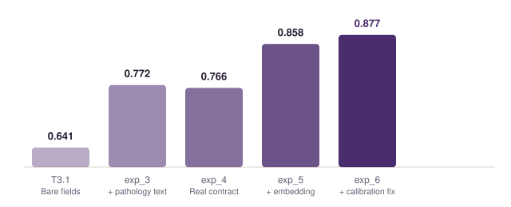
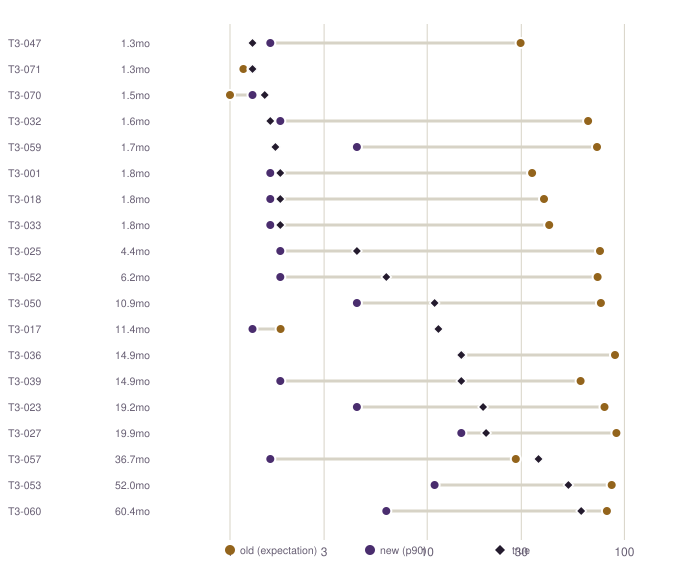
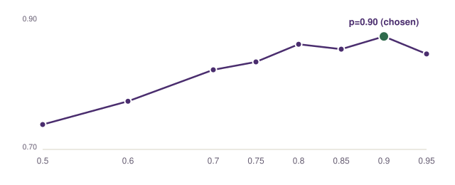
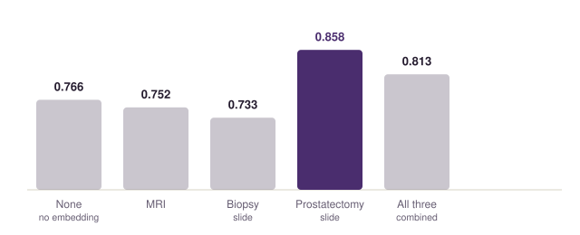

# CHIMERA-Agent Task 3 — Biochemical Recurrence Solution

Contributed from the `challenge_chimera_v3` project. This directory is **additive only** — it does
not modify anything else in this repository or branch; everything below is new.

Task 3 predicts time to biochemical recurrence (BCR) after radical prostatectomy: a single float,
`months_to_recurrence`, scored by Harrell's concordance index (C-index) against the true
time/event pair. No decision, confidence, or variable-weight sub-tasks — the simplest output shape
of the three CHIMERA tasks.

## Result



| Stage | What changed | LOOCV C-index |
|---|---|---|
| Baseline (T3.1) | 4 bare structured fields (age, PSA, DRE, prior treatment) | 0.641 |
| + pathology-text extraction | Regex-parsed ISUP grade, stage, margins, EPE, SVI, LN status from the surgical pathology report | 0.766 |
| + model sweep, real output contract | Ridge-penalized Cox (λ=0.3), scored on the literal predicted date, not a hazard proxy | 0.766 |
| + prostatectomy-slide embedding | PCA-reduced (k=5) tissue-image embedding fused into the same Cox model | 0.858 |
| **+ calibration fix** | Percentile-based point estimate (p=0.90) instead of the mean — fixes a severe bias, see below | **0.877** |

The embedding-fusion gain (0.766 → 0.858) is bootstrap-significant: 2,000-resample paired bootstrap
gives a 95% interval of **[+0.028, +0.176]**, comfortably clear of zero — the strongest single
result in this project's task-3 work. The calibration-fix gain (0.858 → 0.877) is borderline on
C-index alone (95% CI [−0.002, +0.046]) but never worse, and decisively fixes something else
entirely — see below.

## The model

A single ridge-penalized Cox proportional-hazards model:

```
h(t | x) = h₀(t) · exp(β·x)
```

fit over an 18-dimensional covariate vector `x` — 13 clinical/pathology fields plus 5 PCA components
of a pooled prostatectomy-slide embedding — via Efron-corrected partial likelihood with an L2
penalty (λ = 0.3, found by a full leave-one-out sweep over 0.01–2.0, not a library default).

A full worked derivation (every equation, why it was applied, and what each term means) lives in
`equations.md` in this folder.

### The point estimate: a real fix, not a footnote

The first shipped version reported `predict_expectation()` — the mean of the fitted survival
curve. A systematic calibration check across all 19 cases with a known true outcome (event=1) found
this severely biased: **+40.1 month mean overestimate**, up to 11× on cases that recurred within a
year. Cause: with 75% of this cohort censored, the mean gets dragged far right by a long,
poorly-supported tail beyond the last real observation — a known property of "mean" vs. "median"
under heavy censoring, not a bug specific to any case.



The fix swept `predict_percentile(p)` for p ∈ {0.5, ..., 0.95} — p=0.90 (the time by which 10% of
the population would have recurred, a much shorter and better-defined quantile than the median)
wins on **both** axes: C-index 0.8575→0.8765, event=1 bias +40.1mo→**−9.7mo**, MAE 42.2mo→**10.0mo**.



### Inputs

| # | Field | Source | Meaning |
|---|---|---|---|
| 1–2 | `age`, `psa` | `structured-prompt.json` | Age at surgery, pre-op PSA |
| 3–5 | `dre_abnormal`, `dre_bilateral`, `dre_ct_stage_ordinal` | `structured-prompt.json`, parsed | Digital rectal exam findings |
| 6–13 | `isup_grade_group`, `pt_stage_ordinal`, `epe_present`, `margins_positive`, `svi_present`, `lvi_present`, `ln_assessed`, `ln_positive` | `…clinical-data.json` → surgical pathology report, regex-parsed | Post-surgical pathology findings |
| 14–18 | 5 PCA components | `…neural-representations.json` → `"Prostatectomy slide"` embeddings, masked-mean pooled then PCA-reduced | Tissue-image signal not captured by discrete grading |

### Output

`Task3Output`: `case_id`, `months_to_recurrence` (float ≥ 0), `reasoning` (free text, template-generated,
citing the pathology findings that drove the prediction). No `event` field — the schema doesn't
define one, and only the time is scored.

### Why prostatectomy-slide, specifically



The working hypothesis going in favored the MRI embedding (a different modality, a different time
point, nothing like it elsewhere in the inputs) over the prostatectomy-slide embedding (expected to
be redundant with the pathology text already extracted from the same tissue). The result inverted
that prediction — MRI and biopsy-slide embeddings both *hurt*; only prostatectomy-slide helped, and
by a wide margin. Treated as a "too good, check for leakage" result before trusting it (case-ID
alignment, PCA-leakage, and raw-correlation checks all passed — see `experiments/exp_5_embedding_fusion/`).

## What's here

```
task3_solution/
├── README.md                       — this file
├── MODEL_CARD.md                   — full preprocessing + model-selection narrative
├── equations.md                    — full mathematical derivation
├── charts/                         — the 4 SVGs embedded above
├── code/                           — production code, reference/documentation
│   ├── extract_features_task3.py   — closed-vocabulary regex feature extraction
│   ├── task3_embeddings.py         — masked-mean pooling + raw-file embedding fallback
│   ├── task3_config.py             — model registry, the winning Cox+embedding adapter
│   ├── task3_schema.py             — Task3Output (pydantic)
│   ├── task3_free_text.py          — reasoning-text generator
│   ├── models_bridge_task3.py      — production model fit + save
│   ├── run_task3_agent.py          — production inference (raw new cases)
│   ├── run_task3_agent_loocv.py    — honest, leakage-free LOOCV evaluation
│   ├── task3_variant_tester.py     — in-memory model-swap test harness
│   ├── local_eval_task3.py         — scores against the real evaluate.py functions
│   ├── simulate_production_task3.py — end-to-end raw-file production dry-run
│   └── interactive_task3.py        — interactive real-time case tester (REPL)
├── experiments/
│   ├── exp_3_pathology_text_extraction/  — T3.6: 0.641 → 0.766
│   ├── exp_4_model_sweep_and_agent/      — T3.4/T3.5: agent built, Cox penalizer swept
│   ├── exp_5_embedding_fusion/           — T3.2/T3.3: 0.766 → 0.858, the embedding win
│   └── exp_6_calibration_check/          — the +40mo bias found and fixed: 0.858 → 0.877
└── results/
    └── summary.json                — key metrics, machine-readable
```

**Note on running this code**: it's provided as reference/documentation of the approach, not a
standalone package. It depends on the full `challenge_chimera_v3` project — the downloaded CHIMERA
training data (`data/processed/task3/`), the challenge's own evaluation functions
(`external/CHIMERA-agent/evaluation/evaluate.py`), and sibling modules under `experiments/exp_2/scripts/`.
The experiment write-ups and `equations.md` are fully self-contained and readable on their own.

## Honesty notes (carried over, not smoothed out)

- `scikit-survival` (Random Survival Forest / Gradient-Boosted Cox) was evaluated for install and
  is unavailable in the source environment — no C++ compiler toolchain. Not attempted.
- Three parametric AFT families (Weibull, LogNormal, LogLogistic) were tried and lost to Cox (best:
  0.755).
- MRI and biopsy-slide embeddings were tried as the fusion source and both *hurt* performance
  (0.752 and 0.733 respectively) — only the prostatectomy-slide embedding won.
- Radiology-report, previous-notes, and family-history text (three of the five gated clinical-data
  sections) were never extracted into features at all — untried, not refuted.
- The Cox penalizer (λ=0.3) was swept on the pre-embedding feature set and carried forward
  unchanged after the embedding was added — not re-swept on the final feature set.
- A diagnostic-metric paradox was found and explained, not hidden: `mean_time_score` (not part of
  the scored `ranking_score`) actually *drops* under the calibration fix, because that metric's own
  formula rewards blind optimism on censored cases more than it credits accuracy on known-truth
  ones — see `experiments/exp_6_calibration_check/`.

Full detail on all of the above is in `experiments/exp_4_model_sweep_and_agent/summary.md`,
`experiments/exp_5_embedding_fusion/summary.md`, and `experiments/exp_6_calibration_check/summary.md`.
